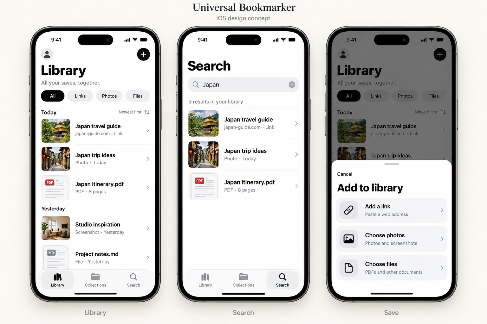

# Universal Bookmarker

A native iPhone library for links, screenshots, photos, PDFs, and files. Save first, organise when useful, and find things again through local search.



## Development status

This repository contains the SwiftUI app, Share extension, portable Swift packages, Supabase backend source, tests, and GitHub Actions. It is a development build: native Xcode validation, live backend setup, signing, and device testing remain required. See [verification and remaining work](docs/build-status.md).

The [existing web prototype](https://universal-bookmark.vercel.app/) has not been changed or connected to this backend. Its source is not included here. The [shared API contract](docs/backend-contract.md) provides the integration boundary for a future web client.

## Features

- Save links, photos, screenshots, PDFs, and other files; up to 20 files per import and 25 MiB per original.
- Browse Library, Collections, and Search, with list/grid views and layered folder cards.
- Search titles, websites, filenames, and notes locally; collections are optional.
- Preview, rename, move, share, and delete saves through native controls.
- Keep a device-only library without configuring a server.
- Connect email-code authentication to a private Supabase library, with queued changes, conflict resolution, and retry states.
- Capture through the iOS Share extension. Captures are saved locally; opening the main app imports and syncs them.

## Run the iOS app

Use macOS with Xcode 16 or newer, Python 3, and an iOS 17 or newer simulator. The project uses Swift 6 and local packages with no third-party iOS dependencies.

From a checkout or extracted source archive, run these commands in the `universal-bookmarker` directory:

```sh
python3 scripts/generate_project.py
open ios/UniversalBookmarker.xcodeproj
```

Select the **UniversalBookmarker** scheme and an iPhone simulator, then run. Backend settings are empty by default, so the app starts with an empty device-only library. A signed device build needs unique bundle identifiers, an Apple development team, and matching App Group entitlements for the app and extension. Copy `ios/Configuration/Secrets.example.xcconfig` to the ignored `Secrets.xcconfig` in the same directory to supply your settings. Open the main app once before using Share capture.

For account sync, follow [backend setup](docs/backend-setup.md). Never put a Supabase service-role key in the app or repository.

## Checks

```sh
swift test --package-path Packages/BookmarkCore
swift test --package-path Packages/BookmarkCloud
npm ci --prefix supabase/tests
npm test --prefix supabase/tests
python3 scripts/generate_project.py
git diff --exit-code -- ios/UniversalBookmarker.xcodeproj
```

Backend tests require Node.js 24 or newer. They use an embedded PostgreSQL engine with Supabase auth/storage fixtures. Portable checks run on Linux or macOS. The [GitHub workflow](.github/workflows/ios.yml) also builds the app and runs native tests on a macOS simulator; portable success alone does not establish an iOS build result.

## Repository guide

| Path | Responsibility |
| --- | --- |
| `ios/UniversalBookmarker` | SwiftUI screens, SwiftData, originals, sessions, sync |
| `ios/ShareExtension` | Durable capture through a scoped App Group inbox |
| `Packages/BookmarkCore` | Domain values, validation, search, import limits, capture protocol |
| `Packages/BookmarkCloud` | Authenticated REST/storage transport |
| `supabase` | Private schema, policies, mutation/change RPCs, account functions, tests |
| `scripts/generate_project.py` | Deterministic Xcode project and shared scheme |
| `docs` | Architecture, setup, verification, design references, decisions |

Read the [architecture](docs/architecture.md), [contribution guide](CONTRIBUTING.md), and [security guidance](SECURITY.md). The [design specification](docs/superpowers/specs/2026-10-23-universal-bookmarker-ios-design.md) records product scope. The approved dragging-bookmark identity still needs its original assets before final app branding.
